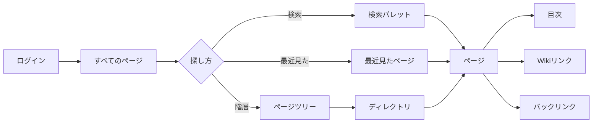
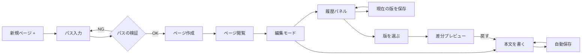
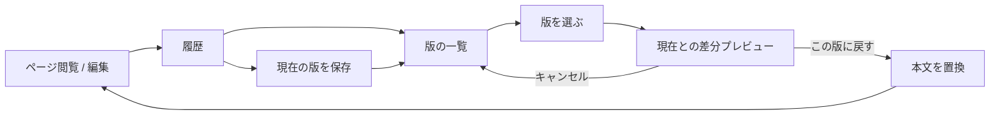
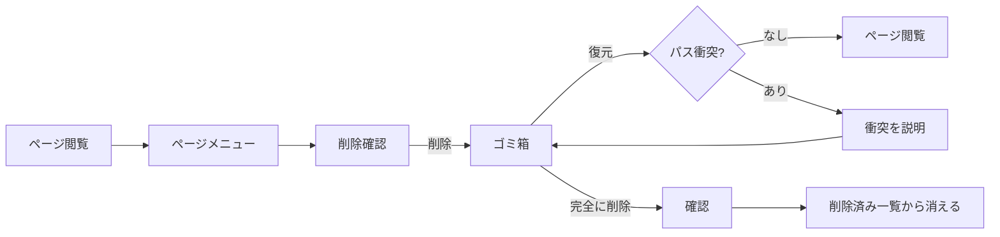

# 1. ユーザーの業務の説明

## 目的

Zeee を使うユーザーの目的、主な関心、典型的な流れを整理し、他の情報設計アウトプットの妥当性を判断する基準にする。

この資料は画面遷移図ではない。個々の画面や操作ではなく、ユーザーが何を達成したいかに焦点を当てる。

## プロダクトの境界

- Zeee は Zli のメンバーだけが使う社内知識ベース。
- ログインした全員が全ページを閲覧・編集できる。ロール、ページ単位 ACL、承認フローはない。
- ページは Markdown で、`/` 区切りのパスを表示名に持つ。
- ディレクトリはページのパスから導出される。空ディレクトリ、ディレクトリ単体の作成・rename はない。
- コメント、通知、添付、タグ、Space、公開共有は対象外。

## 登場人物

| 人物             | 説明                                          | できること                                                     |
| ---------------- | --------------------------------------------- | -------------------------------------------------------------- |
| Zli メンバー     | Zeee の主利用者。新人から既存メンバーまで含む | ログイン、全ページの閲覧・検索・作成・編集・rename・削除・復元 |
| 未ログイン訪問者 | ログインしていない人                          | ログイン画面を見る。ページ本文は見られない                     |

役割を分けない。編集者、管理者、オーナーという概念は IA に持ち込まない。

## 主な関心

1. 目的のページに早く着く
2. 正しいディレクトリにページを置く
3. ページを読み、目次・リンク・バックリンクで理解を深める
4. 書いた内容を失わず、共同編集できる
5. 現在地（どのディレクトリの、どのページか）を見失わない
6. 変更を確認し、必要なら前の版に戻す
7. 誤って削除したページを復元する

## ユーザーの流れ

### 1. 探す・読む

- 既知のページは、検索、最近見たページ、ページツリーのどれからでも開ける。
- 未知の話題は、検索パレットで検索し、結果一覧 (`/?q=`) に進める。
- ディレクトリは、サイドバーのツリー、ディレクトリビューの子ディレクトリリンク、パンくずから辿れる。
- ページを開いたら、本文、目次、Wiki リンク、バックリンクを行き来できる。
- 検索結果が 0 件の場合は、検索クエリを初期値にして新規ページを作れる。
- 検索は全ページ横断。ディレクトリ内検索は MVP 外。`q` と `dir` が同時にある場合は `q` を優先する。

### 2. 作る・書く

- 新規ページは常設の `+` から始める。モバイルでも深いメニューに隠さない。
- パスは 1 つの入力で、ページ作成とディレクトリ作成のモード切替はない。
- パスの初期値は、操作を始めた文脈で決める。初期値は入力途中の prefix であり、最後のセグメントを入れるまで保存できない。

| 開始位置             | 初期値（入力途中の prefix） | 補足                             |
| -------------------- | --------------------------- | -------------------------------- |
| すべてのページ       | 空                          |                                  |
| ディレクトリ `a/b`   | `a/b/`                      | 最後のセグメントを入力する       |
| ページ `a/b/c`       | `a/b/`（親ディレクトリ）    | 兄弟ページを作る                 |
| 検索結果が 0 件      | 検索クエリ                  | 結果がある場合はプリフィルしない |
| 未作成の Wiki リンク | リンク先のパス              | 未解決リンクから作成             |
| ゴミ箱               | 空（文脈なし）              |                                  |

- 作成後はページ閲覧に移り、本文が空なら「本文を書く」導線を出す。
- 本文は編集モードで書き、自動保存される。手動でチェックポイントを作る場合は、履歴パネルの「現在の版を保存」を使う。自動保存と手動保存は別物として表示する。
- ページのパス変更は編集モードで行い、フォーカスを外すか Enter で保存する。
- 既存ページ `a/b` の下に `a/b/c` は作れない。ページをディレクトリにしたい場合は、`a/b` を rename または削除してから子ページを作る。この制約は新規ページダイアログでも説明する。

### 3. 名前を変える・整理する

- ページの rename はパスの変更として行う。ディレクトリの移動も同じ操作。
- ページは葉なので、子ページの一括更新は起きない。
- ディレクトリ自体の rename、空ディレクトリの作成は MVP 外。UI に出さない。
- rename で旧パスは alias として残り、旧 Wiki リンクは解決できる。active なパスが alias より優先される。
- rename 後は、サイドバー、パンくず、検索結果の表示が新しいパスに更新される。

### 4. 変更を追う・戻す

- 履歴はページの補助パネルで開く。独立した画面にはしない。閲覧モードと編集モードの両方から開ける。
- 版の一覧には、版番号、日時、手動/自動、作成者を表示する。
- 版の一覧から 1 つ選び、現在の本文との差分を見てから復元する。履歴行の操作は「差分を見る」とし、復元はプレビュー内の「この版に戻す」で行う。
- 復元は現在の本文を置き換え、新しい版として保存される。履歴は消えない。
- 手動で「現在の版を保存」もできる。自動保存とは別物として表示する。
- 履歴を開くと目次/バックリンクのサイドパネルは閉じ、履歴を閉じると元の補助パネルに戻る。

### 5. 削除・復元

- ページ削除はソフトデリート。ゴミ箱に移動する。
- ゴミ箱から復元できる。同じパスの active ページがある場合は復元できない。自動 rename はしない。
- 完全削除はゴミ箱からだけ行い、確認ダイアログを出す。
- 削除後はゴミ箱に移動し、復元できることを見せる。

### 6. ログイン・ログアウト

- 未ログインならログイン画面を表示する。ログイン後は元のページに戻る。
- ログアウトはアカウントメニューから行う。
- セッション切れの場合は、ページを表示せずログイン導線を出す。

## 主要ユースケース

| #   | ユースケース                         | 頻度 | 重要度 | 主なビュー                         |
| --- | ------------------------------------ | ---- | ------ | ---------------------------------- |
| 1   | 既知のページを検索で開く             | 高   | 高     | 検索パレット → ページ              |
| 2   | 最近見たページから戻る               | 高   | 中     | サイドバー → ページ                |
| 3   | ページツリーからディレクトリを辿る   | 中   | 高     | サイドバー / ディレクトリ → ページ |
| 4   | ページを読み、目次・リンクを辿る     | 高   | 高     | ページ                             |
| 5   | ディレクトリを指定してページを作る   | 中   | 高     | ディレクトリ → 新規ページ          |
| 6   | ページを編集し、自動保存する         | 高   | 高     | ページ（編集）                     |
| 7   | ページのパスを変える                 | 中   | 中     | ページ（編集）                     |
| 8   | 履歴を見て前の版に戻す               | 低   | 高     | ページ → 履歴 → 版プレビュー       |
| 9   | ページを削除し、ゴミ箱から復元する   | 低   | 高     | ページ → ゴミ箱                    |
| 10  | 未作成の Wiki リンクからページを作る | 中   | 中     | ページ → 新規ページ                |

## IA への要件

1. **検索は全ページ横断**。どの画面からでも 1 つの入口で開ける。
2. **最近見たページはショートカット**。階層や主ナビと混ぜない。
3. **新規ページは常設**。モバイルでも隠さない。初期値は文脈から決め、保存は完全なパスで行う。
4. **Directory は Page のパスから導出**。Space や Root pages という別概念を作らない。
5. **現在地は 1 か所にまとめる**。パンくずとページ名をヘッダー間で分散させない。
6. **目次・バックリンク・履歴は Page の補助**。独立したナビにしない。
7. **Trash は Page の状態**。独立したオブジェクトにしない。
8. **すべての操作に対象がある**。何を編集・削除・復元するのかを画面上で特定できる。
9. **同じものは同じ名前**。UI、API、DB、ドキュメントで `Page` / `Directory` / `Revision` を使う。
10. **削除・復元の失敗理由を説明する**。パス衝突を黙って処理しない。

## スコープ外

- コメント、通知、承認
- 添付ファイル、画像アップロード
- タグ、お気に入り、スター
- Space、チームスペース
- ページ単位 ACL、ゲスト閲覧
- 公開共有 URL
- ディレクトリ rename、空ディレクトリ
- ディレクトリ内検索
- ページの複製
- リアルタイム共同編集の在席表示の詳細（既存機能として維持）

## 現状の課題

- グローバルヘッダーにパンくずとページ名があり、ページ本文側のページ名と文脈が分散している。
- `/` の画面名が「ページ」、サイドバーが「すべてのページ」で、同じ対象に 2 つの名前がある。
- 新規ページの初期値が常に空で、ディレクトリ文脈を引き継げない。
- 検索入口がグローバルヘッダー、モバイルの検索フォーム、検索結果一覧に分かれている。
- 履歴を開くと目次/バックリンクが閉じるが、開閉の見た目が別 UI に見え、同じ補助領域の切替として一貫していない。
- ゴミ箱の復元で 409 が起きたとき、パス衝突の理由を十分に説明していない。
- `Spaces` は既存の `Directory` と重複するため、IA から除外する。
