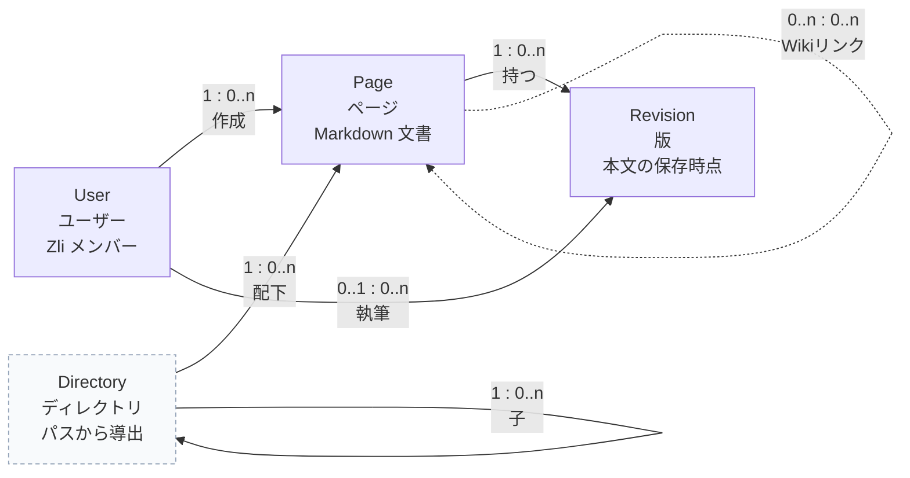

# 2. 概念モデル

## 目的

Zeee を利用するユーザーが認知する主要な概念と、その関係性を俯瞰する。ここではデータベースのテーブルや API の形ではなく、ユーザーのメンタルモデルに近い単位で整理する。

## 概念モデル

- 実線は親子関係、点線は参照関係。
- `Directory` は点線枠で示す。ユーザーには見えるが、独立した保存 Entity ではない。
- `Page` の自己参照は、本文中の Wiki リンクによるページ間参照。
- 多重度は「親 : 子」「参照元 : 参照先」の順に読む。

## 概念

| 概念                         | 定義                                                                                                | ユーザーにとっての意味                 |
| ---------------------------- | --------------------------------------------------------------------------------------------------- | -------------------------------------- |
| **Page / ページ**            | `/` 区切りのパスをタイトルに持つ Markdown 文書。UUID で識別される。ページは葉で、子ページを持たない | 知識の単位。探す・読む・書く対象       |
| **Directory / ディレクトリ** | active な Page のパスの proper prefix としてのみ存在するグループ。ID も保存行も持たない             | ページを整理して辿るための入れ物       |
| **Revision / 版**            | Page 本文の保存時点。自動保存と手動保存がある。Page に属する                                        | 変更を確認し、前の状態に戻すための単位 |
| **User / ユーザー**          | Zli のメンバー。ログインし、Page と Revision を作る                                                 | 誰が書いたか、誰が編集しているか       |

## 関係性

| 関係                  | 多重度      | 説明                                                                                            |
| --------------------- | ----------- | ----------------------------------------------------------------------------------------------- |
| User → Page           | 1 : 0..n    | ユーザーはページを作成する。ページの作成者は 1 人                                               |
| User → Revision       | 0..1 : 0..n | ユーザーは版を保存する。版の作成者は 1 人だが、自動保存では不明な場合がある                     |
| Directory → Page      | 1 : 0..n    | ディレクトリは配下にページを持つ。各 Page はちょうど 1 つの親 Directory に属する（root を含む） |
| Directory → Directory | 1 : 0..n    | ディレクトリは子ディレクトリを持つ。親は 0..1                                                   |
| Page → Revision       | 1 : 0..n    | ページは版を持つ。版は必ず 1 つのページに属する                                                 |
| Page → Page           | 0..n : 0..n | Wiki リンクによる参照。参照元と参照先は多対多になり得る。保存された Link Entity ではない        |
| Page → 旧パス         | 1 : 0..n    | rename で旧パスを alias として保持する。ユーザー向けには Page のプロパティ                      |

## 不変条件

1. **active な Page のパスは一意**。同じパスの Page は同時に存在しない。
2. **Page は葉**。`a` が Page なら `a/b` は存在しない。`a/b` が Page なら `a` は Directory。
3. **Page と Directory は同名で共存しない**。`a` が Directory なら `a` という Page は存在しない。
4. **Directory は配下に active な Page がある間だけ存在する**。空ディレクトリは作れない。
5. **削除済み Page は active 集合の外**。同じパスを新しい Page が使える。復元時に衝突したら失敗する。
6. **自動 rename をしない**。衝突はユーザーが解決する。
7. **rename の旧パスは alias として残る**。Wiki リンクは active なパスを優先し、次に alias を解決する。
8. **ログインユーザーは全ページを編集できる**。ページ単位の権限概念はない。

## 概念ではないもの

| 名前                             | 扱い                    | 理由                                                                    |
| -------------------------------- | ----------------------- | ----------------------------------------------------------------------- |
| **Space**                        | 使わない                | Directory と同じものを別名で呼ぶことになる                              |
| **Home**                         | 使わない                | ルートは「すべてのページ」。独立した Home を作ると All pages と重複する |
| **Root pages / Browse**          | 使わない                | すべてのページの別名、または同じ階層の別表現                            |
| **Trash**                        | Page の状態             | `deleted_at` を持つ Page の一覧。独立した Entity ではない               |
| **Search**                       | ビュー / プロセス       | 全 Page を横断する検索。概念ではなく機能                                |
| **Recent**                       | ビュー / ショートカット | ユーザーごとの閲覧履歴。Page の関係ではない                             |
| **History**                      | Revision のビュー       | Revision の一覧。独立した概念ではない                                   |
| **Backlink**                     | Link の逆方向ビュー     | 保存された Entity ではなく、本文中の参照から導出する                    |
| **Alias**                        | Page のプロパティ       | 旧パス。Page の同一性は UUID のまま                                     |
| **Path**                         | Page のプロパティ       | ページの表示名と同一。別の Title 列は持たない                           |
| **目次 / サイドバー / ヘッダー** | UI のビュー             | 情報構造ではなく、表示部品                                              |

## 妥当性の確認

SmartHR の概念モデルの観点に照らす。

| 観点                                 | 確認結果                                                                                                                                       |
| ------------------------------------ | ---------------------------------------------------------------------------------------------------------------------------------------------- |
| DB 構造をそのまま写していないか      | `page_alias`、`page_body`、`revision`、`app_user` をそのまま概念にしていない。ユーザーが認知する Page / Directory / Revision / User に整理した |
| 業務に即した名前か                   | `Page`、`Directory`、`Revision` は UI と運用で使う語に合わせた。`Space` は使わない                                                             |
| グルーピングが業務に即しているか     | Directory は「ページを整理して辿る」単位。Page の単なる属性ではなく、ユーザーが階層として認知する                                              |
| 「〇〇の▢▢」という概念がないか       | Page のパス、Page の旧パスはプロパティとして扱う。独立した「Page の Title」は作らない                                                          |
| 動作を表す言葉が概念になっていないか | Search、Edit、Delete は概念ではなくビューまたはアクション                                                                                      |
| 同じ末尾の概念が複数ないか           | Page / Directory / Revision / User の 4 つ。Space、Root pages、Browse は作らない                                                               |
| 階層が深すぎないか                   | 概念は 4 つ。Page と Directory の関係は 1 階層の親子で、Page は葉                                                                              |
| 1:1 の関係が連続していないか         | Page と Revision は 1:0..n。Page と Directory は 0..n:1。1:1 の連鎖はない                                                                      |
| 親子関係の名前が自然か               | 「Directory の配下 Page」「Page の Revision」は自然。「Page の Space」は作らない                                                               |

## 未決事項

- Wiki リンクを「Link という概念」として見せるか、Page 間の参照関係として扱うか。この資料では後者にした。
- Directory を「概念」として図に残すか、Page のパスから導出されるビューとして図から外すか。ユーザーが階層を認知するため、概念モデルには残した。
- 旧パス（alias）をユーザー向けにどこまで見せるか。IA では Page のプロパティとし、独立した画面は作らない。
