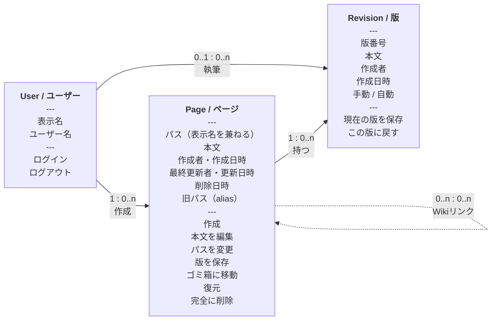

# 3. オブジェクトモデル

## 目的

ユーザーが Zeee を使ううえで主要な関心の対象となるオブジェクトと、そのプロパティ・アクション・関係性を整理する。UI の骨格（何を見せ、何を操作できるべきか）を検討するための資料であり、D1 のデータモデルや API の設計図ではない。

## オブジェクトモデル

- 実線は親子関係、点線は参照関係。
- **Directory はオブジェクトではない**。active な Page のパスから導出するスコープであり、この図には含めない。概念モデルと 04/05 で扱う。
- Page の親 Directory は 0..1。root 直下の Page は親 Directory を持たない。
- 閲覧・確認はアクションに含めない。アクションはユーザーがデータや状態を変える操作に限る。
- 自動保存、自動 revision、検索インデックス更新はシステム処理なので、アクションに含めない。

## Page / ページ

| 項目                   | 内容                                                                                                          |
| ---------------------- | ------------------------------------------------------------------------------------------------------------- |
| **定義**               | `/` 区切りのパスを表示名に持つ Markdown 文書。Zeee の知識の単位                                               |
| **プロパティ**         | パス（フルパス）、本文、作成者、作成日時、最終更新者、更新日時、削除日時、旧パス（alias）                     |
| **アクション**         | 作成、本文を編集、パスを変更、版を保存、ゴミ箱に移動、復元、完全に削除                                        |
| **条件付きアクション** | 復元と完全に削除は削除済みの Page だけ。パス変更は active な Page だけ                                        |
| **関係**               | 0..1 の親 Directory に属する（root 直下は親なし）。0..n の Revision を持つ。Wiki リンクで他の Page を参照する |
| **UI 上の主なビュー**  | ページ（閲覧）、ページ（編集）、ページヘッダー、削除確認、ゴミ箱の行                                          |

補足:

- パスはページの表示名を兼ねる。末尾セグメントは「ページ名」として表示する。別の表示名は持たない。
- ページは葉であり、子ページを持たない。`a` が Page なら `a/b` は作れない。
- パス変更は「移動」も兼ねる。ディレクトリの一括 rename は Page のアクションではない。
- 旧パスは rename 時に alias として残る。ユーザーが直接編集するプロパティではない。
- 本文の自動保存はシステム処理。ユーザーのアクションは「本文を編集」。
- ページの複製は MVP 外。必要になったら Page のアクションとして追加する。

## Revision / 版

| 項目                  | 内容                                                       |
| --------------------- | ---------------------------------------------------------- |
| **定義**              | Page 本文の保存時点。Page に属する                         |
| **プロパティ**        | 版番号、本文、作成者、作成日時、手動 / 自動の種別          |
| **アクション**        | 現在の版を保存、この版に戻す                               |
| **関係**              | 必ず 1 つの Page に属する。Page は 0..n の Revision を持つ |
| **UI 上の主なビュー** | 履歴パネル、版プレビュー、復元確認                         |

補足:

- 「現在の版を保存」は手動の Revision を作るアクション。
- 「この版に戻す」は Page の本文を置き換えるアクション。復元後の内容は新しい Revision として保存される。
- 版の内容を閲覧する行為はアクションではない。履歴パネルと版プレビューで行う。
- 履歴パネルは閲覧モードと編集モードの両方から開ける。編集モードでも手動の版保存ができる。
- 自動保存・自動 revision はシステム処理。ユーザーのアクションには含めない。

## User / ユーザー

| 項目                  | 内容                                                                           |
| --------------------- | ------------------------------------------------------------------------------ |
| **定義**              | Zli のメンバー。Zeee にログインして Page と Revision を作る                    |
| **プロパティ**        | 表示名、ユーザー名                                                             |
| **アクション**        | ログイン、ログアウト                                                           |
| **関係**              | 0..n の Page を作成する。0..n の Revision を保存する                           |
| **UI 上の主なビュー** | ログイン、アカウントメニュー、ページの作成者・更新者表示、共同編集中の在席表示 |

補足:

- ユーザー管理、ロール管理、ページ単位の権限は MVP 外。
- ログインユーザーは全ページを編集できる。
- 在席表示は一時的な状態であり、永続的なオブジェクトではない。

## Directory / ディレクトリ（派生スコープ、オブジェクトではない）

Directory は active な Page のパスの proper prefix として導出されるスコープであり、オブジェクトモデルには含めない。独自のプロパティ・アクション・ライフサイクルを持たない。root scope は Directory ではなく、root 直下の Page は親 Directory を持たない。

UI では次の場所に現れる。

- サイドバーのページツリー
- ディレクトリビューの子ディレクトリリンクとパンくず
- パス入力のディレクトリ候補

Directory の作成・rename・削除・移動は MVP 外。展開・折りたたみはビューの状態であり、オブジェクトのアクションではない。

## オブジェクトではないもの

| 名前                         | 扱い                            | 理由                                                                  |
| ---------------------------- | ------------------------------- | --------------------------------------------------------------------- |
| **Link / Wiki リンク**       | Page 本文から導出されるパス参照 | 解決済み/未解決の状態を持つ。独立した行・ID・ライフサイクルを持たない |
| **Backlink**                 | Link の逆方向ビュー             | 参照元 Page の一覧。保存されたオブジェクトではない                    |
| **Directory / ディレクトリ** | 派生スコープ                    | Page のパスから導出する。独立したプロパティ・アクションを持たない     |
| **Alias / 旧パス**           | Page のプロパティ               | rename の履歴。Page の同一性は UUID                                   |
| **Trash**                    | Page の状態                     | 削除済み Page の一覧ビュー                                            |
| **Search result**            | ビュー                          | 検索条件に一致した Page の表示                                        |
| **Recent page**              | ビュー / ショートカット         | ユーザーごとの閲覧履歴                                                |
| **History**                  | Revision のビュー               | Revision の一覧                                                       |
| **Sidebar / Header / Card**  | UI の器                         | レイアウトを示す言葉であり、業務のオブジェクトではない                |
| **Excerpt**                  | Page の派生プロパティ           | 本文から生成する表示用の抜粋                                          |
| **Audit event**              | システムの記録                  | ユーザーが直接操作する対象ではない                                    |

## アクションの確認

| アクション     | 対象            | 主体     | UI                             |
| -------------- | --------------- | -------- | ------------------------------ |
| 作成           | Page            | ユーザー | 新規ページダイアログ           |
| 本文を編集     | Page            | ユーザー | ページ（編集）                 |
| パスを変更     | Page            | ユーザー | ページ（編集）のパス入力       |
| 版を保存       | Page → Revision | ユーザー | 履歴パネルの「現在の版を保存」 |
| ゴミ箱に移動   | Page            | ユーザー | ページメニュー → 削除確認      |
| 復元           | Page            | ユーザー | ゴミ箱の行                     |
| 完全に削除     | Page            | ユーザー | ゴミ箱 → 完全削除確認          |
| 現在の版を保存 | Revision        | ユーザー | 履歴パネル                     |
| この版に戻す   | Revision → Page | ユーザー | 版プレビュー                   |
| ログイン       | User            | ユーザー | ログイン画面                   |
| ログアウト     | User            | ユーザー | アカウントメニュー             |

含めないもの:

- 自動保存、自動 revision、検索インデックス更新（システム）
- 閲覧、確認、目次を開く、履歴を開く（ビュー）
- Directory の展開・折りたたみ（ビューの状態）
- Directory の rename、空ディレクトリの作成（MVP 外）
- Page の複製（MVP 外）

## プロパティの確認

| 観点                                                   | 確認結果                                                                                                                        |
| ------------------------------------------------------ | ------------------------------------------------------------------------------------------------------------------------------- |
| オブジェクトが複数のプロパティとアクションを持つか     | Page と Revision は複数持つ。User はプロパティとログイン/ログアウトを持つ。Directory はオブジェクトではないため図と表から外した |
| 画面上のレイアウト言葉がオブジェクト名になっていないか | 「一覧」「ツリー」「パネル」はオブジェクトにしていない                                                                          |
| 文字列・数値・日付をオブジェクトにしていないか         | パス、本文、日時、版番号はプロパティとして扱う                                                                                  |
| 「〇〇の▢▢」というプロパティ名がないか                 | 「Page のパス」「Page の旧パス」は Page のプロパティ。独立した Path オブジェクトは作らない                                      |
| アクションの主体がユーザーか                           | 自動保存・自動 revision はシステム処理として除外した                                                                            |
| 基本アクションが不足していないか                       | 作成、編集、rename（移動）、削除、復元、完全削除、版の保存、版の復元を揃えた                                                    |
| 概念モデルと矛盾していないか                           | Page / Revision / User のオブジェクト関係は概念モデルと一致。Directory は概念モデルにだけ残る派生スコープ                       |

## UI への含意

| オブジェクト | 必要なビュー                                                | 必要なアクション                                   |
| ------------ | ----------------------------------------------------------- | -------------------------------------------------- |
| Page         | ページ（閲覧 / 編集）、ページヘッダー、削除確認、ゴミ箱の行 | 作成、編集、パス変更、版保存、削除、復元、完全削除 |
| Revision     | 履歴パネル、版プレビュー                                    | 現在の版を保存、この版に戻す                       |
| User         | ログイン、アカウントメニュー、在席表示                      | ログイン、ログアウト                               |

Directory はオブジェクトではないため、この表には含めない。UI ではサイドバーのツリー、ディレクトリビューの子ディレクトリリンク、パンくず、パス入力候補に現れる。

この対応表を満たさない UI（例: Directory の rename ボタン、History という独立画面、Search という独立オブジェクト）は、IA と矛盾する。
