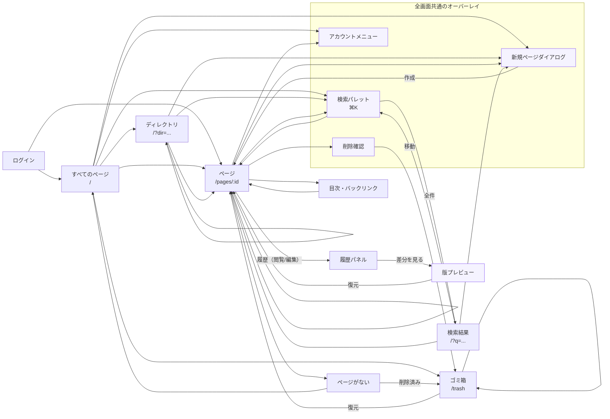

# 4. ビューの呼び出し関係

## 目的

オブジェクトがどのようなビューとしてユーザーに現れ、ビュー同士がどのような呼び出し関係でつながるかを整理する。画面遷移図ではなく、オブジェクトとビューの対応、および主要な行き来を可視化する。

## ビューの一覧

| ビュー                   | 対象オブジェクト                  | 入口                                       | 主な役割                                                                     |
| ------------------------ | --------------------------------- | ------------------------------------------ | ---------------------------------------------------------------------------- |
| **ログイン**             | User                              | `/auth/login`、セッション切れ              | ログインし、元の画面に戻る                                                   |
| **すべてのページ**       | Page の集合                       | `/`、ブランド、サイドバー                  | 全ページを更新順で見る。検索・ツリー・新規作成の起点                         |
| **ディレクトリ**         | Page の集合（Directory で scope） | `/?dir=...`、ツリー、パンくず              | ディレクトリ配下のページを一覧で見る。子ディレクトリは一覧上部のリンクで辿る |
| **検索結果**             | Page の集合（検索で絞り込み）     | `/?q=...`、検索パレットの「すべての結果」  | 検索結果を全件一覧し、ページを開く。0 件なら結果から新規作成もできる         |
| **ページ（閲覧）**       | Page                              | `/pages/:id`                               | 本文、目次、Wiki リンク、バックリンクを読む                                  |
| **ページ（編集）**       | Page                              | ページ（閲覧）のモード切替                 | 本文とパスを編集する。自動保存される。履歴パネルも開ける                     |
| **ページサイドパネル**   | Page の目次 / Backlink            | ページ（閲覧）                             | 目次とバックリンクを同じ補助領域に出す                                       |
| **履歴パネル**           | Revision の集合                   | ページの「履歴」（閲覧/編集）              | 版の一覧、手動保存、復元の起点                                               |
| **版プレビュー**         | Revision                          | 履歴パネルの「差分を見る」                 | 現在との差分を見て復元する                                                   |
| **ゴミ箱**               | 削除済み Page の集合              | `/trash`                                   | 削除済みページの復元・完全削除                                               |
| **検索パレット**         | Page の集合 / Recent              | グローバルヘッダー、`⌘K`                   | 横断検索（上位 5 件）と最近見たページのショートカット                        |
| **新規ページダイアログ** | Page                              | グローバルヘッダーの `+`、各文脈の作成導線 | パスを入力して Page を作る                                                   |
| **削除確認**             | Page                              | ページメニュー                             | ゴミ箱に移動する前に確認する                                                 |
| **完全削除確認**         | Page                              | ゴミ箱                                     | 本文と履歴を消す前に確認する                                                 |
| **ページがない**         | Page                              | `/pages/:id` の不一致・削除済み            | 一覧へ戻る。削除済みならゴミ箱への導線も出す                                 |

## 呼び出し関係

- `Login --> Page` は、ログイン前に開こうとしたページへ戻る経路。
- `Page --> Page` は Wiki リンクとバックリンク。同じ Page ビューを別の Page で開く。
- `Dir --> Dir` は子ディレクトリとパンくず。同じディレクトリビューを別の scope で開く。
- `Trash --> Trash` は完全削除後に同じゴミ箱へ留まる経路。
- `Search --> Results` は「すべての結果を見る」。パレット内の結果から直接 Page を開く経路もある。

## 画面内のビュー

実際の UI では、複数のビューを 1 画面に表示する。SmartHR の注意点に合わせ、画面単位で囲む。

| 画面           | URL          | 含まれるビュー                                                                | 共通シェル                                   |
| -------------- | ------------ | ----------------------------------------------------------------------------- | -------------------------------------------- |
| すべてのページ | `/`          | すべてのページ、ディレクトリ（`dir`）、検索結果（`q`）、サイドバーのツリー    | グローバルヘッダー、検索パレット、新規ページ |
| ページ         | `/pages/:id` | ページ（閲覧 / 編集）、ページサイドパネル、履歴パネル、版プレビュー、削除確認 | グローバルヘッダー、検索パレット、新規ページ |
| ゴミ箱         | `/trash`     | ゴミ箱、完全削除確認                                                          | グローバルヘッダー、検索パレット、新規ページ |
| ページがない   | `/pages/:id` | ページがない、ゴミ箱への導線                                                  | グローバルヘッダー、検索パレット、新規ページ |
| ログイン       | `/auth/...`  | ログイン                                                                      | なし（未ログイン用シェル）                   |

- `/?dir=...` と `/?q=...` は別画面ではなく、すべてのページ画面のビュー状態。
- ページ（閲覧）とページ（編集）は同じ画面のモード。別 URL にはしない。
- ページサイドパネルと履歴パネルは Page 画面内の補助ビュー。独立した URL にしない。
- 版プレビュー、削除確認、完全削除確認、新規ページ、検索パレットはオーバーレイ。画面遷移ではなく、元の画面の上に開く。
- アカウントメニューは全画面共通のオーバーレイ。ログアウトだけを行う。

## 呼び出しのルール

1. **Page を開く操作は同じタブで行う**。Wiki リンク、バックリンク、検索結果、ツリー、Recent のどれも同じ。
2. **Directory を開く操作は同じタブで行う**。子ディレクトリ、パンくず、ツリーの順で階層を移動する。
3. **検索パレットは元の画面の上に開く**。パレットは上位 5 件を表示し、結果を選ぶと Page へ移動して閉じる。「すべての結果」は検索結果ビューへ移動する。`q` と `dir` が同時にある場合は `q` を優先する。
4. **新規ページは元の文脈を引き継ぐ**。ディレクトリ、ページ、検索結果が 0 件のとき、未作成 Wiki リンクから開いた場合、初期値（入力途中の prefix）を埋める。最後のセグメントを入れるまで保存できない。
5. **作成後は Page へ移動する**。中間の一覧画面を挟まない。
6. **削除後はゴミ箱へ移動する**。削除確認の後、復元できる場所を見せる。
7. **復元後は Page へ移動する**。復元できなかった場合はゴミ箱に留まり、理由を表示する。
8. **版の復元後は Page へ移動する**。履歴パネルは閉じてもよいが、現在の版が更新されたことを示す。
9. **履歴とページサイドパネルは排他**。履歴は閲覧/編集の両方から開ける。履歴を開くと目次/バックリンクを閉じ、目次/バックリンクを開くと履歴を閉じる。履歴行は「差分を見る」、復元はプレビュー内の「この版に戻す」で行う。
10. **オーバーレイは移動時に閉じる**。検索パレット、新規ページ、削除確認、版プレビューを開いたまま別の Page に移動しない。
11. **ページがない場合は一覧へ戻す**。削除済みの場合はゴミ箱への導線も出す。
12. **フラットな一覧はフルパスで表示する**。ツリーは末尾セグメント、All pages / Recent / Trash / パレットの Recent / 検索結果はフルパス。

## ビューにしないもの

| 名前                       | 理由                                                           |
| -------------------------- | -------------------------------------------------------------- |
| **Home**                   | ルートは「すべてのページ」。独立した Home ビューは作らない     |
| **Spaces**                 | Directory と同じ。独立したビューにしない                       |
| **Browse / Root pages**    | すべてのページや Directory の別名                              |
| **Recent ページ**          | サイドバーと検索パレットの空状態で十分。独立したビューにしない |
| **Directories 一覧ページ** | ディレクトリはツリーとパンくずから辿る。独立した一覧にしない   |
| **History ページ**         | 履歴は Page の補助パネル。独立した URL にしない                |
| **TOC ページ**             | 目次は Page 内のサイドパネル。独立したビューにしない           |
| **Search 専用ページ**      | 検索結果は `/?q=` のビュー状態。独立したアプリにしない         |

## ユーザーの流れとの対応

| ユーザーの流れ                       | ビューの経路                                             |
| ------------------------------------ | -------------------------------------------------------- |
| 既知のページを検索で開く             | すべてのページ → 検索パレット → ページ                   |
| 最近見たページから戻る               | サイドバー（Recent） → ページ                            |
| ページツリーからディレクトリを辿る   | すべてのページ → ディレクトリ → ページ                   |
| ページを読み、目次・リンクを辿る     | ページ → ページサイドパネル / Wiki リンク / バックリンク |
| ディレクトリを指定してページを作る   | ディレクトリ → 新規ページ → ページ                       |
| ページを編集し、自動保存する         | ページ（閲覧） → ページ（編集） → ページ（閲覧）         |
| ページのパスを変える                 | ページ（編集） → パス入力 → ページ（閲覧）               |
| 履歴を見て前の版に戻す               | ページ → 履歴パネル → 版プレビュー → ページ              |
| ページを削除し、ゴミ箱から復元する   | ページ → 削除確認 → ゴミ箱 → ページ                      |
| 未作成の Wiki リンクからページを作る | ページ → 新規ページ → ページ                             |

## 未決事項

IA の新規未決はない。モバイルでページサイドパネルと履歴パネルを同じシートにするか、別のシートにするかは UI 契約で決める。

## 現状との差分

- 現状のグローバルヘッダーはパンくずとページ名も持つ。目標ではページヘッダーに移す。
- 現状の `/` は「ページ」という名前で、すべてのページ画面として整理されていない。
- 現状のモバイル `/` には検索フォームがある。目標では検索入口をグローバルヘッダーに一本化する。
- 現状の履歴はサイドパネルを置き換えるが、開閉の見た目が別 UI になっている。目標では同じ補助領域の切替として扱う。
- 現状の削除後は `/` に戻る。目標ではゴミ箱へ移動する。
